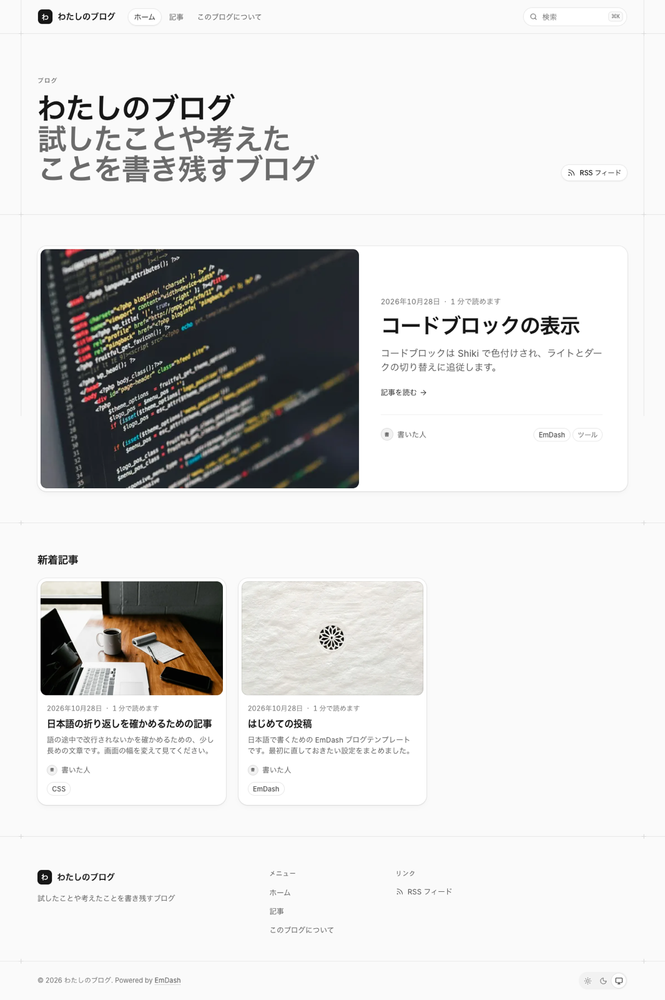

# emdash-blog-ja

日本語で書くための [EmDash](https://github.com/emdash-cms/emdash) ブログテンプレートです。公式の [blog-cloudflare](https://github.com/emdash-cms/templates/tree/main/blog-cloudflare) を元に、文言・日付・折り返し・フォントを日本語向けに直しています。個人が作った非公式のテンプレートです。



## 使い方

```bash
npx giget@latest gh:okinako-chan/emdash-blog-ja my-blog
cd my-blog
npm install
npm run dev
```

GitHub の「Use this template」からも作れます。

http://localhost:4321/_emdash/admin でセットアップすると、日本語のサンプル記事が入ります。デプロイは `npm run deploy` です。

## ライセンス

MIT
